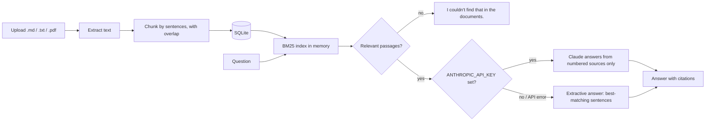

# RAG Document Assistant

Ask questions about your own documents and get answers **with citations** to the passages they came from. Upload Markdown, text or PDF files, ask in plain English, and see exactly which source supports each sentence.

It works **out of the box with no API key**: retrieval and an extractive answer run locally. Set `ANTHROPIC_API_KEY` and answers are written by Claude instead, still grounded only in the retrieved passages.


**Why this project:** most retrieval-augmented generation (RAG) demos stop at "call an LLM with some context". The interesting engineering is everything around that call:
- **Retrieval you can explain.** It should be clear why a passage was chosen.
- **A guardrail when the documents don't cover the question,** instead of a confident made-up answer.
- **A graceful fallback** when the model API is unavailable.

## How it works



## Run it locally

You need Python 3.12 or newer.

```bash
git clone https://github.com/Riya-086/rag-document-assistant.git
cd rag-document-assistant
python -m venv .venv
source .venv/bin/activate          # Windows: .venv\Scripts\activate
pip install -r requirements.txt
uvicorn rag_assistant.api:app --reload
```

Open http://127.0.0.1:8000. Three sample policy documents (in `sample-docs/`, for a fictional company) are loaded on first start, so you can ask right away. Try:

- "How many days a week can I work remotely?"
- "What is the meal allowance when travelling?"
- "When should an on-call engineer escalate?"

Interactive API docs are at http://127.0.0.1:8000/docs.

### Optional: answers written by Claude

```bash
export ANTHROPIC_API_KEY=your-key       # Windows PowerShell: $env:ANTHROPIC_API_KEY="your-key"
uvicorn rag_assistant.api:app --reload
```

| Environment variable | Purpose | Default |
|---|---|---|
| `ANTHROPIC_API_KEY` | Turns on LLM-written answers | not set (extractive answers) |
| `LLM_MODEL` | Claude model to use | `claude-haiku-5-5` |
| `DATABASE_PATH` | SQLite file for documents | `documents.db` |
| `LOAD_SAMPLE_DOCS` | Load `sample-docs/` when the database is empty | `1` |

## API

| Method | Path | Purpose |
|---|---|---|
| `POST` | `/api/documents` | Upload a file (multipart `file`, up to 2 MB) |
| `GET` | `/api/documents` | List documents with their chunk counts |
| `DELETE` | `/api/documents/{id}` | Remove a document and its chunks from the index |
| `POST` | `/api/ask` | `{"question": "...", "top_k": 4}` returns `answer`, `grounded`, `mode` and numbered `sources` |

## Tests

```bash
pip install -r requirements-dev.txt
pytest        # 11 tests
```

The tests cover:
- Chunking limits and overlap
- BM25 ranking
- PDF upload, then asking about it, then deletion
- Refusing questions the documents don't cover
- Upload validation (type, size, empty files)
- The Claude request format, using a mocked HTTP transport
- Falling back to the extractive answer when the API fails

GitHub Actions runs lint, format checks and the tests on every push.

## Design decisions

**BM25 instead of vector embeddings.** Keyword ranking needs no model download and no API calls, and its scores can be explained term by term. For policy-style documents, where questions reuse the documents' own words, it performs well.
- Tradeoff: it misses pure synonyms ("WFH" vs "remote"). The retrieval layer is one class (`BM25Index`), so adding an embedding index for hybrid search is a contained change.

**A relevance guardrail before the model.** If nothing scores above a threshold, the API answers "I couldn't find that in the documents" without calling the LLM. That prevents made-up answers and saves cost.

**Numbered sources and a strict system prompt.** The model sees only the retrieved passages, labelled `[1]`, `[2]`, and must cite them or say it can't find the answer.

**Graceful degradation.** Any LLM error falls back to the extractive answer, and the response's `mode` field says which path produced it.

**Sentence-based chunks with overlap.** Chunks end on sentence boundaries, and neighbouring chunks share a sentence, so an answer that spans a boundary is still found.

## What I'd add next

- Hybrid retrieval: BM25 combined with embeddings
- Reranking of the retrieved passages
- An evaluation set of questions and expected sources, scored in CI
- Streaming answers to the browser
- Per-user document collections
